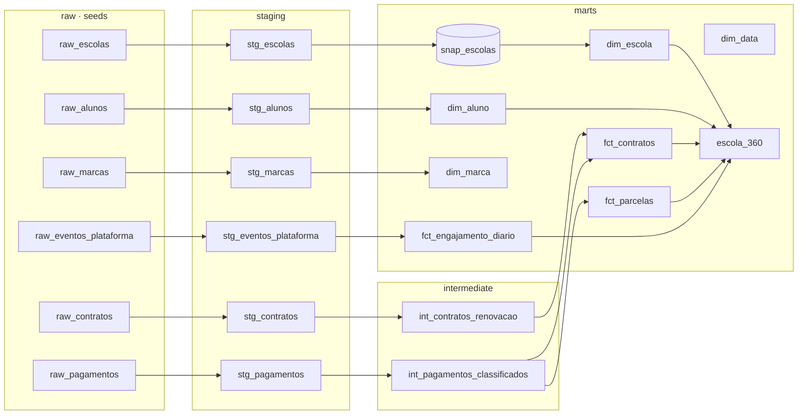

# Educação Analytics · projeto dbt

Projeto de Analytics Engineering com **dbt + Databricks** sobre uma empresa fictícia de soluções
educacionais: ela vende sistemas de ensino, plataformas digitais e serviços para escolas particulares.

O objetivo é transformar dados brutos de contratos, pagamentos, alunos e uso da plataforma em um
modelo analítico **confiável, testado e documentado**, pronto para responder perguntas como:

- Quais escolas renovaram, quais foram perdidas e quanto a receita contratada variou?
- Qual a inadimplência por escola, marca e região?
- Os alunos estão usando a plataforma? Quais escolas têm risco de não renovar?

## Por que este projeto

Trabalhei anos construindo pipelines de transformação no **SAS Enterprise Guide** e depois
participei da migração para o **Azure Databricks**. Este projeto reconstrói esse tipo de trabalho
com dbt, para trazer as práticas que faltavam no legado: versionamento, testes automáticos,
documentação e lineage.

| No SAS Enterprise Guide | Neste projeto |
| --- | --- |
| Nós de PROC SQL e data steps | Models `.sql` |
| Setas do fluxo entre os nós | `ref()`, que monta o DAG |
| Macros SAS | Macros Jinja (`converter_moeda_br`) |
| Tabelas temporárias da WORK | Camada `intermediate` |
| Conferência manual de totais | Testes de dados, testes unitários e contratos |
| Documentação em Word | `dbt docs` com descrições e lineage |
| Agendamento no servidor SAS | Job do Databricks definido como código (`databricks.yml`) |

## Arquitetura



| Camada | Materialização | Papel |
| --- | --- | --- |
| `raw` | seeds | Simula a camada de pouso. Em produção viria de uma ferramenta de ingestão. |
| `staging` | view | Uma por fonte: limpeza, tipagem, padronização e deduplicação. Sem regra de negócio. |
| `intermediate` | view | Regras de negócio reaproveitáveis. |
| `marts` | table / incremental | Star Schema e a tabela orientada à entidade `escola_360`. |

## Modelo de dados

| Model | Tipo | Grão |
| --- | --- | --- |
| `fct_contratos` | fato | um contrato (escola × marca × ano letivo) |
| `fct_parcelas` | fato | uma parcela de contrato |
| `fct_engajamento_diario` | fato incremental | um aluno em um dia com uso da plataforma |
| `dim_escola` | dimensão | uma escola (versão atual; histórico SCD 2 em `snap_escolas`) |
| `dim_aluno`, `dim_marca`, `dim_data` | dimensões | um aluno, uma marca, um dia |
| `escola_360` | entidade | uma escola, com indicadores de contrato, financeiro e engajamento |

## Decisões de modelagem

- **Grão primeiro.** Cada fato declara o grão no topo do arquivo e tem teste de unicidade nele.
- **Staging sem regra de negócio.** Status de parcela e renovação ficam no `intermediate`, num só
  lugar, e são reaproveitados pelas fatos.
- **Data de referência fixa** (`var data_referencia`). Torna os resultados reprodutíveis e permite
  recalcular indicadores "como estavam" em outra data.
- **Incremental com janela de reprocessamento.** `fct_engajamento_diario` reprocessa os últimos
  3 dias e faz `MERGE` por aluno × dia, para absorver eventos que chegam atrasados.
- **Histórico com snapshot.** Mudanças de status, porte e tamanho da escola ficam versionadas
  (SCD tipo 2) em vez de sobrescritas.
- **Tabela orientada à entidade.** `escola_360` evita que quem consome precise saber fazer os
  joins certos. Tem **contrato de dados** ativo: nomes e tipos de coluna são garantidos.

## Qualidade de dados

- **Testes genéricos:** `unique`, `not_null`, `relationships`, `accepted_values` e testes do
  `dbt_utils` em todas as camadas.
- **Teste na origem com severidade `warn`:** a fonte de eventos reenvia registros. O teste avisa
  sem parar o pipeline, e o staging deduplica.
- **Teste unitário** da regra de status das parcelas (`unit_tests` em `_intermediate.yml`).
- **Testes singulares** em `tests/`: soma das parcelas igual ao valor do contrato e nenhum
  pagamento antes da assinatura. Este último encontrou datas incoerentes no gerador de dados
  durante o desenvolvimento.
- **CI no GitHub Actions:** todo pull request roda `dbt parse`.

## Como rodar no Databricks Free Edition

1. Crie uma conta no [Databricks Free Edition](https://docs.databricks.com/aws/en/getting-started/free-edition).
2. Em **SQL Warehouses**, abra o warehouse e copie *Server hostname* e *HTTP path*
   (aba *Connection details*). Gere um token em **Settings → Developer → Access tokens**.
3. Instale o dbt e as dependências:
   ```bash
   python -m venv .venv && source .venv/bin/activate
   pip install -r requirements.txt
   ```
4. Configure o profile e as variáveis de ambiente:
   ```bash
   cp profiles.example.yml profiles.yml
   export DATABRICKS_HOST=dbc-xxxx.cloud.databricks.com
   export DATABRICKS_HTTP_PATH=/sql/1.0/warehouses/xxxx
   export DATABRICKS_TOKEN=dapi...
   ```
5. Rode o projeto:
   ```bash
   dbt deps
   dbt build          # seeds, snapshot, models e testes na ordem do DAG
   dbt docs generate && dbt docs serve
   ```

Para regenerar os dados: `python scripts/gerar_dados.py`.

## Orquestração

`databricks.yml` define, como código (Databricks Asset Bundle), um job diário que roda
`dbt deps` e `dbt build` em um SQL warehouse. A separação é a mesma de qualquer stack moderna:
o dbt define **o que** transformar e o orquestrador (Databricks Jobs, Airflow, Dataform)
define **quando**.

## Próximos passos

- `source freshness` quando a ingestão for contínua.
- Métricas na camada semântica do dbt (receita contratada, inadimplência, engajamento).
- Testes de volume e de distribuição (por exemplo, com `dbt-expectations`).
- Ambiente de CI com `dbt build` em um schema temporário a cada pull request.
